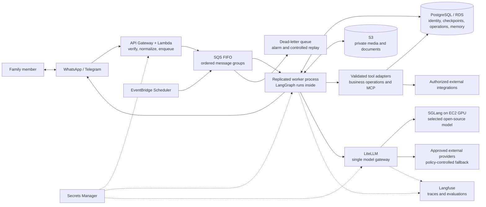
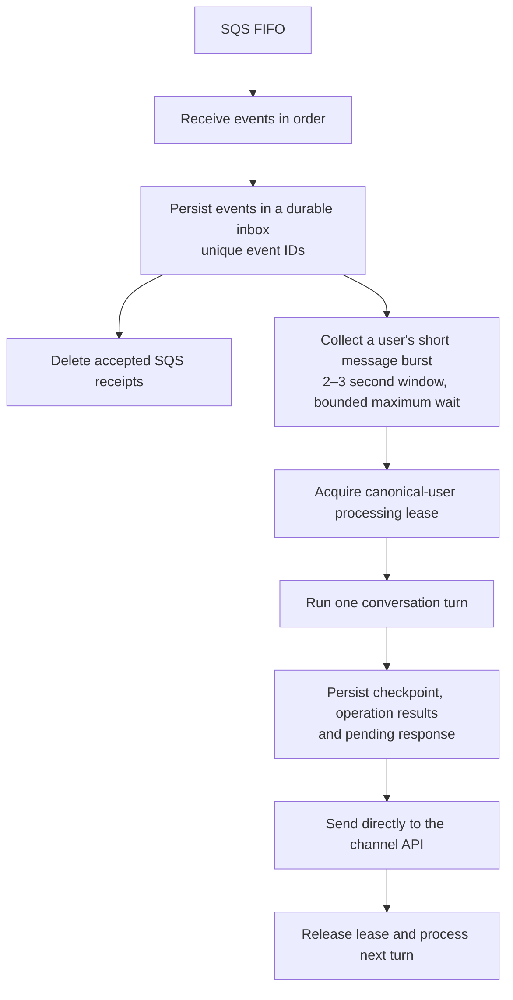
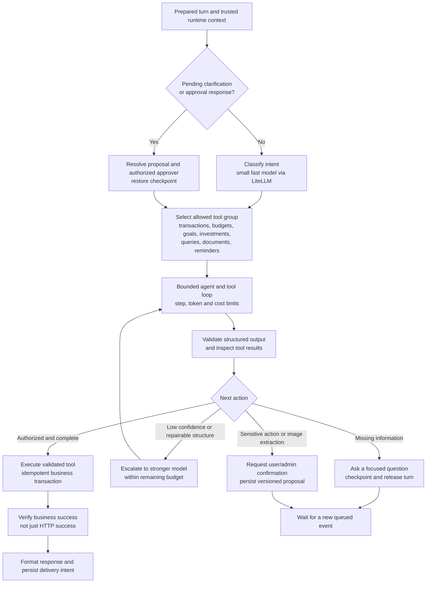
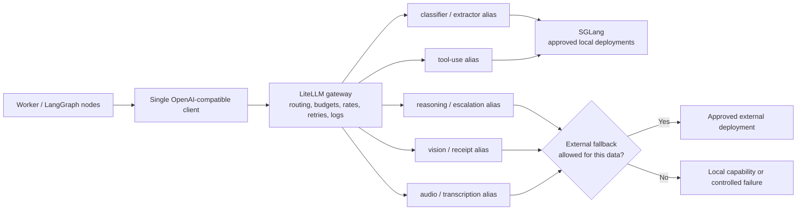
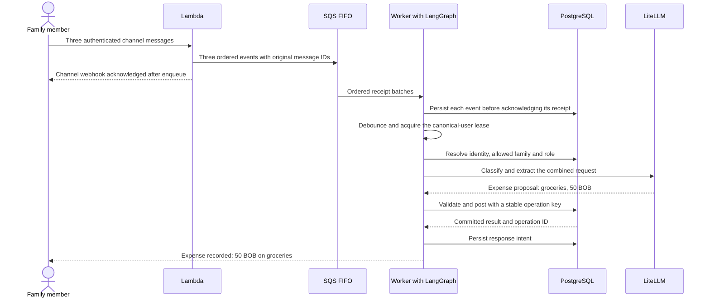
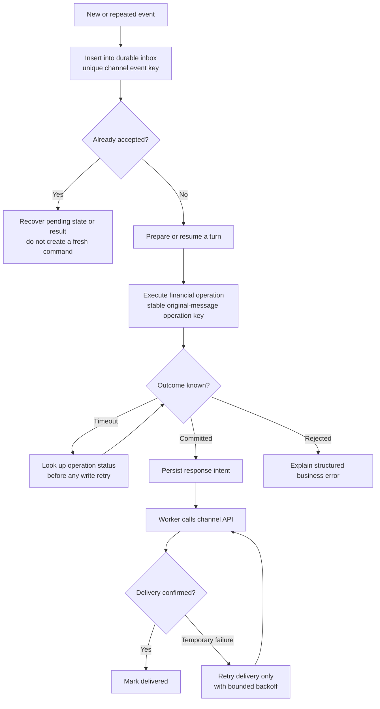

# AI Financial Assistant — Technical Details

[Back to the simple architecture overview](ai-attention-architecture.md).

> **Decision: target architecture selected by the project owner. Implementation is pending.**
>
> Scope: AI-assisted conversations, channel delivery, model routing, tools, memory, and supporting infrastructure. This document does not redesign the application or the accounting model, and does not provision AWS resources or migrate existing data.

## 1. What we are building

A conversational family financial assistant that records income and expenses, explains budgets and savings progress, manages goals and investments, and helps family members act within their permissions.

The entry point is WhatsApp, with Telegram supported through the same normalized message contract. Start with **one agent and scoped tool groups**, not a network of autonomous agents. Introduce subagents only when evaluations demonstrate that the single-agent design is insufficient.

The selected production path is:

**Channel → API Gateway / Lambda → SQS FIFO → worker containing LangGraph → channel API.**

All model requests go through **LiteLLM**. Production inference can use **SGLang on an EC2 GPU**, with policy-controlled external fallbacks. PostgreSQL stores durable state and enforces business authorization. **n8n is not part of this target conversation path.** Existing workflows can remain during the transition, but must not also execute the same financial commands. **FastAPI is not required**; it may be introduced later for administrative endpoints or third-party callbacks.

## 2. Overall architecture



The worker is a long-running container that consumes messages. LangGraph is a Python library inside that process, **not a separate agent server**. LiteLLM and SGLang are separate model-serving components. LangChain is optional: the worker can use an OpenAI-compatible client against LiteLLM without adopting LangChain agents.

The worker sends channel responses directly to Meta or Telegram. Neither channel is used to execute an actual bank transfer or exchange order in this design: investment and vault operations record internal movements in our financial system.

## 3. Ingress: small, stateless, and database-free

Lambda performs a limited set of deterministic operations:

1. Answer Meta's GET verification challenge using the configured verification secret.
2. Authenticate incoming events: verify WhatsApp's `X-Hub-Signature-256` against the **original raw request body** and app secret; validate Telegram's webhook secret token.
3. Discard irrelevant events, including delivered/read status notifications.
4. Normalize each actual message in a batched channel payload, preserving its identifier and order.
5. Enqueue a small event containing text and/or media references, then return HTTP 200 immediately after SQS accepts it.

Do not parse and reserialize the body before signature verification. Handle API Gateway's encoding correctly. Failed authentication is rejected; failed enqueueing must not return a success acknowledgment that loses the message.

Lambda does not query PostgreSQL, download media, run a model, or wait for an agent response. Secrets live in Secrets Manager. Queue payloads never contain files, model credentials, or a model-selected family identity.

Example normalized envelope, **proposed rather than an existing API contract**:

```json
{
  "event_id": "whatsapp:business-account:channel-message-id",
  "channel": "whatsapp",
  "channel_account_id": "business-account",
  "sender_ref": "verified-channel-sender",
  "message_id": "channel-message-id",
  "received_at": "2026-11-01T15:00:00Z",
  "kind": "user_message",
  "text": "I spent 50 BOB on groceries",
  "media_ref": null,
  "trace_id": "correlation-id"
}
```

`sender_ref` means the sender extracted from an authenticated channel event, not a phone number supplied in the user's text. Unknown senders receive a controlled account-linking flow; a message alone cannot claim an existing user's identity.

## 4. Queue ordering, retries, and debounce

Use an SQS **FIFO** queue:

- **MessageGroupId:** the user ordering key. Before database identity resolution, namespace the channel sender by channel and receiving account. The worker then resolves the canonical user and serializes their turns, including messages arriving through different channels.
- **MessageDeduplicationId:** the channel's `message.id`, namespaced where necessary to avoid collisions between accounts/channels. System events have their own stable occurrence IDs.
- **DLQ:** repeatedly failing events go to a dead-letter queue, with an alarm and a replay procedure. Inspect context before replaying an old financial request. Removing a poisoned event can create a gap in the user's sequence; do not silently continue a dependent action.
- **Delivery semantics:** application handlers must tolerate replay. FIFO's short deduplication window does not replace persistent command idempotency.

### Making the 2–3 second debounce work with FIFO

The assistant should combine a short burst such as “I spent 50” → “on groceries” → “for our home” into one turn. A worker cannot hold the first FIFO message invisible and expect a later receive to provide more messages from the same group. Consequently, implement **two internal stages inside the same worker deployment**:



The durable inbox is the recovery source after queue acknowledgment. Every replica can recover ready or abandoned turns from it. Do not acknowledge a receipt after copying a message into process memory only. Debounce preserves all original event IDs; a combined turn does not erase provenance.

This is one deployment with intake and turn-processing loops, not a requirement for two new microservices. It preserves the intended **one active turn per person**, while allowing consecutive events to reach the durable inbox. SQS may deliver multiple messages from one group in a batch; never process those concurrently.

Set a conservative visibility timeout above the longest active receipt-processing path and extend it dynamically when needed. If a handler retains a receipt through an entire turn, that timeout must exceed the longest turn too. With early durable handoff, a **separate renewable processing lease** protects the turn after SQS acknowledgment. On shutdown, stop taking new work, finish or durably checkpoint current work, and release/recover leases safely.

Scale identical worker replicas using queue depth **and durable-inbox ready-turn backlog**, message age, and processing latency. Queue depth alone is insufficient when intake acknowledges messages before the agent finishes. Different users can run in parallel; a single user does not gain throughput by adding replicas.

## 5. Worker turn lifecycle

| Stage | Responsibility |
|---|---|
| Debounce | Collect a short ordered burst without waiting indefinitely for a continuously typing user. |
| Identity | Resolve phone/channel identity to user, family membership and role in PostgreSQL. Resolve ambiguity before a family-scoped action. |
| Media | Download channel media promptly to private S3, transcribe audio through Whisper, and extract structured receipt data with a vision-capable model. |
| Agent | Run the LangGraph nodes and the selected tool group within explicit budgets. |
| Delivery | Format the actual result for the channel, persist a pending response, and call Meta/Telegram directly. |

Media downloads should begin as soon as their events are accepted; they need not wait for the full reasoning turn or debounce to finish. This reduces exposure to expiring Meta media URLs. Configure MIME/size limits, encrypted storage, access controls and retention/lifecycle rules. Persisting media does not mean retaining it forever.

**All data extracted from a receipt image must be confirmed by the user before financial persistence**, even if extraction confidence is high. Temporary extraction/checkpoint storage is separate from posting a financial operation. Do not interpret invoice text as instructions to the agent.

Start with media processing in the worker. Move heavy or local Whisper work into a dedicated media container if measured latency/CPU/GPU usage justifies it. Its model calls still follow the gateway policy; use compatible audio endpoints where supported, otherwise add a controlled adapter behind that boundary.

## 6. One agent, scoped tool groups



Classification is a constrained routing decision, not a second autonomous agent. Tool exposure is limited by both intent and the user's permissions. A read-only question does not receive financial write or membership-administration tools.

Escalation is bounded and cannot bypass permissions, confirmation, or exhausted cost budgets. Structural/interpretation failures may justify a stronger model; permission denial or insufficient funds do not. A failed tool cannot become successful merely because an LLM rewrites the explanation.

Subagents are a later option, introduced only if evaluations show meaningful improvement in correctness, latency or cost. Large tool counts alone are not a reason to create many independent agents.

## 7. Tool and authorization boundary

Rules are enforced in **tool code and PostgreSQL**, never only in a prompt.

- Inject `user_id`, `family_id` and role context in trusted code. They are not model-editable tool arguments; avoid exposing internal identifiers in the model context. Models can select user-facing names/opaque choices that code resolves against authorized resources.
- For multiple families, ask which permitted family applies; changing a family selection invalidates an incompatible pending proposal.
- Validate each tool's input schema, role permissions, timeout and business limits. Use parameterized functions for reads, not model-generated SQL.
- Perform amounts, totals, currency conversion and accounting calculations in deterministic code with decimal-safe arithmetic. The LLM extracts and explains values.
- Financial writes carry a stable idempotency key rooted in the original `message.id`. Add a stable operation index/version when one message contains multiple commands. Approval messages resume the original operation instead of creating a new one.
- Persist the idempotency record and financial changes atomically. Replaying the same key and same payload returns the stored result; reusing the key with different data is rejected.
- Return structured errors with a useful explanation and retryability classification. Never send secrets or raw database traces to the model.
- Prefer MCP for suitable external integrations, with explicit tool allowlists, credentials and timeouts. MCP does not authorize a tool by itself; financial writes retain the same local validation boundary.

An agent restart, a graph checkpoint, or queue deduplication alone does not guarantee one financial write. Side effects must remain idempotent at the business transaction boundary.

## 8. Models: one gateway, configurable roles



Aliases represent configurable roles, not a mandatory mapping of particular roles to external or local providers. Route each to a compatible approved deployment. **The worker never calls a model provider directly.** Network and credential boundaries should enforce that rule, not just developer convention.

LiteLLM supplies provider-facing configuration, fallbacks, rate/cost limits, load balancing and request logs. Preserve a common correlation ID across worker, gateway and inference. Define which data classes may leave the infrastructure **before** enabling external fallback; never silently switch a private document to an unapproved provider.

The target self-hosted inference option is **EC2 GPU, such as g5 or another compatible family, running SGLang** with the selected open-source model. Select GPU/VRAM from the actual model, precision, concurrency and context-length measurements. RadixAttention/prefix caching can reuse common prompts and tool definitions; structured generation supports well-formed outputs, but does not establish semantic correctness or authorization.

Changing a compatible model or engine is intended to be a configuration/alias change rather than an agent rewrite. Tool-calling, vision/audio support, output schemas, latency and accuracy must still pass compatibility checks and evaluations. A string change is not an exemption from testing.

**Ollama is for local development only.** Introduce the always-on GPU deployment after measuring actual usage: at low traffic an approved hosted API can be cheaper than a GPU running continuously.

## 9. State, memory, documents and audit

PostgreSQL runs in a container during development and **RDS in the target production deployment**, with encryption, backups and least-privilege access. This decision does not itself migrate the current Supabase business database or replace its authentication; those integration/migration steps must be planned separately.

| Storage concern | Responsibility |
|---|---|
| Business data | Existing families, users, roles, transactions, income, expenses, budgets, goals and investments. Existing financial rules remain authoritative. |
| Conversation checkpoints | A separate schema for LangGraph state, pending questions, versioned approvals and resume references. |
| Durable inbox and delivery state | Accepted events, stable operation keys, processing leases, responses awaiting delivery and recovery information. |
| Rolling history summary | Compact older context while preserving unresolved proposals and references to authoritative results. |
| Long-term memory | An asynchronous extraction job with deduplication, provenance and update/deletion controls. Do not treat memory as proof of a balance or permission. |
| Family documents | Private S3 content with PostgreSQL/vector metadata, hybrid search and reranking. Filter by family before retrieval and reranking. |
| Audit | Actor, family, action, timestamps, operation ID, result and the exact confirmation/approver where required. |

Enforce family isolation using RLS and a least-privileged database role for agent operations. Role labels such as admin, member and child are mapped by trusted authorization code; do not assume all of those policies are already implemented. Set per-request family context transactionally and prevent connection-pool context leakage. The agent must not receive a broad privileged key as a substitute for this boundary.

A LangGraph checkpoint stores conversation progress; it is not the financial ledger. Persistent balances and calculations come from business functions, not a reconstructed chat history. Summary generation must not remove an unresolved approval or reinterpret an already executed command.

Redis is optional for rate limits or hot state if PostgreSQL is insufficient. It is not required for the initial deployment and must not become the sole source of financial or approval state.

## 10. Example: a short burst becomes one expense

**Messages:** “I spent 50” → “on groceries” → “for the family”.



Acknowledgment refers to the channel's webhook delivery, not a chat response saying the expense is already recorded. For a simple explicit expense, another confirmation is needed only when policy requires it. Defaults such as date, timezone and currency come from code and verified context, not model guesses.

If two authorized families match, checkpoint the proposal and ask which one. Do not select a family arbitrarily. An audio transcript that is ambiguous also requires clarification.

## 11. Example: receipt image and administrator approval

**A child sends a receipt for an amount requiring administrator approval.** Both the extracted data and the authorization must be checked.

```mermaid
sequenceDiagram
    actor C as Child / member
    actor A as Family administrator
    participant Q as Shared SQS FIFO queue
    participant W as Worker with LangGraph
    participant S as Private S3
    participant M as LiteLLM vision route
    participant P as PostgreSQL
    C->>Q: Verified receipt event via Lambda
    Q->>W: Member event
    W->>S: Persist media promptly
    W->>M: Extract structured receipt data
    M-->>W: Items, amount and extraction warnings
    W->>P: Checkpoint proposal; no financial write
    W-->>C: Please confirm the extracted items and total
    C->>Q: Confirmation through the same channel ingress
    Q->>W: Member confirmation event
    W->>P: Validate confirmation and check role/threshold policy
    W->>P: Persist pending administrator approval
    W-->>A: Approval request with exact operation summary
    Note over W,P: Release the turn; do not hold an SQS receipt while waiting
    A->>Q: Approval event through the same authenticated ingress
    Q->>W: Administrator event in the administrator's message group
    W->>P: Verify approver membership and proposal version
    W->>P: Resume original thread and execute once
    P-->>W: Recorded result
    W-->>C: Receipt recorded after approval
```

The administrator has their own FIFO group. Trusted code links their reply to the original pending proposal and resumes the original LangGraph thread under its processing lock. An approval event must carry or resolve an operation reference; a bare “yes” cannot approve one of several ambiguous requests. Never group an administrator's message under a child identity supplied by the model.

Do not hold the child's processing lease while waiting for the administrator. Recheck membership, required role, proposal expiry and payload version at execution time. A changed total requires a new confirmation. Both the member's extraction confirmation and the administrator's authorization are audited.

## 12. Example: savings progress is not investment cash flow

**Question:** “Have we reached our savings goal this month?”.

The query tool reads the existing authorized report. With expected income of 10,000 BOB and a 20% savings allocation, the goal is 2,000 BOB. Actual income of 10,000 minus actual expenses of 8,000 gives 2,000 generated savings: the goal is reached **so far**.

The response distinguishes:

- **Generated this month:** actual income minus actual expenses.
- **Moved this month:** cash transferred to investments or vaults, shown separately.
- **Available now:** accumulated free cash across all months.

Investing the money early does not make it an expense. Leaving it in available cash still counts as generated savings. Investing January's surplus during February does not create new February savings. The tool returns these numbers; the model explains them without reconstructing accounts from chat history.

For an internal vault movement, code prepares the exact proposal. Example: 700 BOB into an existing USD vault at a user-confirmed 7 BOB/USD means 100 USD credited. Persist the original request key, rate, amounts, destination, version and expiry. A confirmation resumes that proposal, revalidates the balance/permissions, and uses the same operation key. This rate is illustrative, not a live quotation.

## 13. Example: duplicate delivery and uncertain outcomes



Queue deduplication, database idempotency and outbound delivery recovery solve different problems. Persist an operation intent before the write; after a crash recover the committed result by its key. Persisting or recovering the response must not trigger another financial write.

If a channel accepted a response but the acknowledgment was lost, a retry can still duplicate the chat message unless the channel provides a suitable deduplication guarantee. Do not claim end-to-end exactly-once delivery. External MCP side effects also need their own idempotency/status strategy before enabling automatic retries.

## 14. Scheduled events, operations and observability

**EventBridge Scheduler** produces reminders, monthly summaries and other proactive events that reenter the same queue as trusted system events. SQS is a delivery queue, not a long-term reminder database. System event IDs must distinguish scheduled occurrences while remaining stable on retry. Configure the FIFO integration's group/deduplication requirements and verify them in an integration test.

At send time, enforce WhatsApp's current customer-service window and approved-template requirements; a scheduled event does not grant permission to send arbitrary free-form messages. Recheck family membership and reminder consent when a schedule fires, rather than retaining stale authorization from its creation.

**Langfuse** provides self-hostable turn traces, latency by stage, model usage/cost and evaluation results. Carry `trace_id` from Lambda to queue, worker, tools and model gateway. Record failures such as tool schema errors, authorization denial, timeouts and exhausted budgets. Redact secrets and minimize financial/chat content in logs and traces; use explicit retention and access controls.

Evaluate real, consented/redacted conversations against every model, prompt or tool change before production. Include multilingual turns, ambiguous amounts/dates, child/admin interactions, receipt mistakes, family switching and injected instructions in documents. Measure end-to-end and per-stage latency before optimizing or introducing more agents.

| Failure | Required behavior |
|---|---|
| Unauthenticated webhook | Reject before enqueueing. |
| Failed queue publish | Do not acknowledge the event as successfully accepted. |
| Repeated message or confirmation | Reuse durable state and the original operation result. |
| Unknown sender or family | Account linking or clarification; no inferred financial access. |
| Invalid structured output | Bounded repair/escalation; no unvalidated write. |
| Permission denial / insufficient funds | Explain and stop; a stronger model cannot override policy. |
| Receipt extraction | Always obtain confirmation before posting. |
| Expired or modified proposal | Rebuild and request new approval. |
| Model/provider unavailable | Approved fallback within policy and budget, otherwise a controlled failure. |
| Worker restart | Recover inbox, checkpoint, processing lease and operation status. |
| Channel send failure after commit | Retry delivery, never repeat the financial write. |
| Repeated poison event | DLQ, alarm and reviewed recovery. |

## 15. Delivery roadmap

1. Lambda + SQS FIFO + worker: authenticated ingress and an echo round trip using a test channel.
2. Identity, family isolation/RLS, durable inbox, processing leases and financial idempotency. Reuse current domain rules; plan any database migration separately.
3. One LangGraph agent, one transaction tool group, and the PostgreSQL checkpointer.
4. LiteLLM as the only model boundary, before live model integration; stages 3 and 4 can be developed together.
5. Audio and images, with mandatory confirmation for image-extracted financial data.
6. Langfuse and the first evaluation set based on representative conversations.
7. Small-model classifier, scoped tool groups, bounded loops and stronger-model escalation.
8. Asynchronous long-term memory extraction and family-scoped document RAG.
9. SGLang GPU inference with compatible aliases and policy-controlled external fallback, once cost/load measurements justify it.
10. TTS, scheduled reminders and cross-user administrator approval.

During migration, route each real incoming event to exactly one financial executor: the existing workflow or this worker. Shadow comparisons use simulated/read-only operations. Do not turn on both writers for the same channel event.

Before each stage is enabled, test duplicate webhooks beyond FIFO's deduplication window, worker termination at each commit boundary, debounce under message bursts, concurrent cross-channel messages, replayed approvals, role changes while waiting, model fallback privacy restrictions, and delivery retries after a successful financial commit.

## References

- [SQS FIFO delivery and message-group behavior](https://docs.aws.amazon.com/AWSSimpleQueueService/latest/SQSDeveloperGuide/FIFO-queues-understanding-logic.html).
- [SQS FIFO deduplication window and key terms](https://docs.aws.amazon.com/AWSSimpleQueueService/latest/SQSDeveloperGuide/FIFO-key-terms.html).
- [LangGraph interrupts and persistent resumption](https://docs.langchain.com/oss/python/langgraph/interrupts).
- [LiteLLM gateway and provider-independent routing](https://docs.litellm.ai/docs/simple_proxy).
- [SGLang inference serving and prefix caching](https://docs.sglang.ai/).
