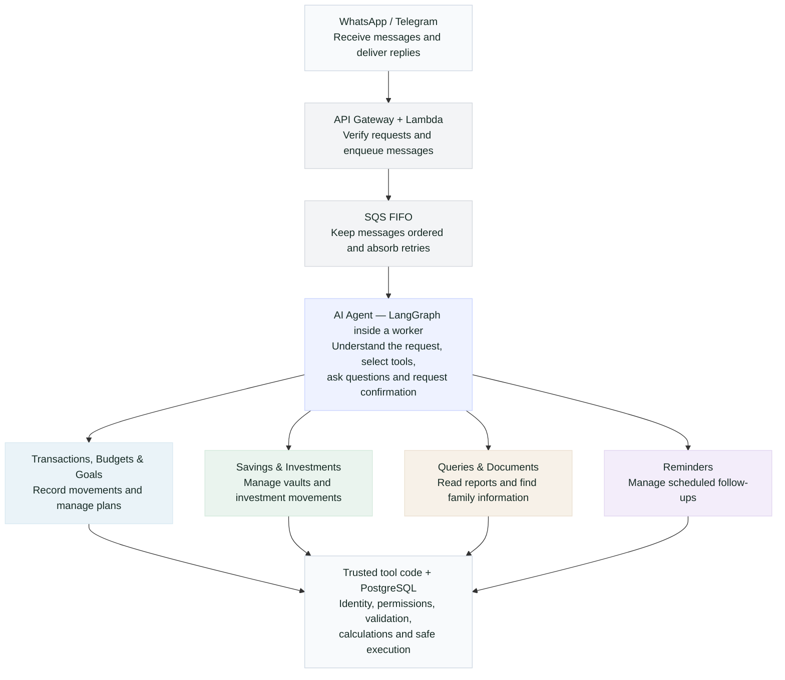

# AI Financial Assistant — Architecture Overview

**Selected design · Not yet implemented.** One conversational agent, organized into tool groups. This page covers AI attention only.

## Main flow

**The four branches are tool groups, not four agents.** The agent only receives the tools relevant to the request and the user's permissions. The worker sends the final response directly to WhatsApp or Telegram; the diagram follows the request direction for readability.

## Responsibilities around the agent

| Component | Responsibility |
|---|---|
| **Worker + LangGraph** | Combine short message bursts, resolve context, process media, conduct the conversation and resume pending confirmations. |
| **LiteLLM** | The single gateway for every model call: choose model aliases, apply limits and control fallbacks. The agent does not call providers directly. |
| **SGLang / model providers** | Run the models. SGLang serves the selected open-source model on an EC2 GPU; approved external providers are fallback options. |
| **PostgreSQL / RDS** | Store identity, family permissions, business records and durable conversation state. Checkpoints are separate from financial data. |
| **S3** | Store private audio, receipt images and documents. Image-extracted financial data always requires confirmation before posting. |
| **EventBridge Scheduler** | Send reminder events back into the queue. The worker checks channel delivery rules before sending. |
| **Langfuse** | Measure latency and cost, trace failures and evaluate conversation quality. |
| **Secrets Manager** | Keep credentials outside prompts, queue messages and source code. |

**LangGraph is a library inside the worker, not another server. LangChain is optional. n8n and FastAPI are not required in this conversation path.**

## Examples from our assistant

| User request | What happens |
|---|---|
| “I spent 50 BOB on groceries.” | The agent selects transaction tools. Code resolves the family and validates the data; the database records the expense once. |
| “Did we reach our savings goal?” | Query tools return this month's actual savings and target. The agent explains the result; investment transfers are shown separately. |
| “Move 700 BOB into my USD travel vault.” | Code prepares the amounts and exchange rate. The agent requests confirmation, then executes the approved internal movement. |
| Sends a receipt image | The worker stores it in S3 and requests structured extraction through LiteLLM. The user confirms the extracted data before it is recorded. |

The model interprets and explains. **Code and the database control permissions, amounts and financial writes.**

[Detailed implementation notes, recovery flows and delivery roadmap](ai-attention-architecture-details.md).
