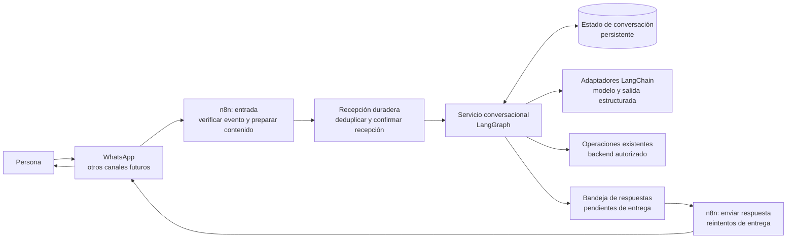
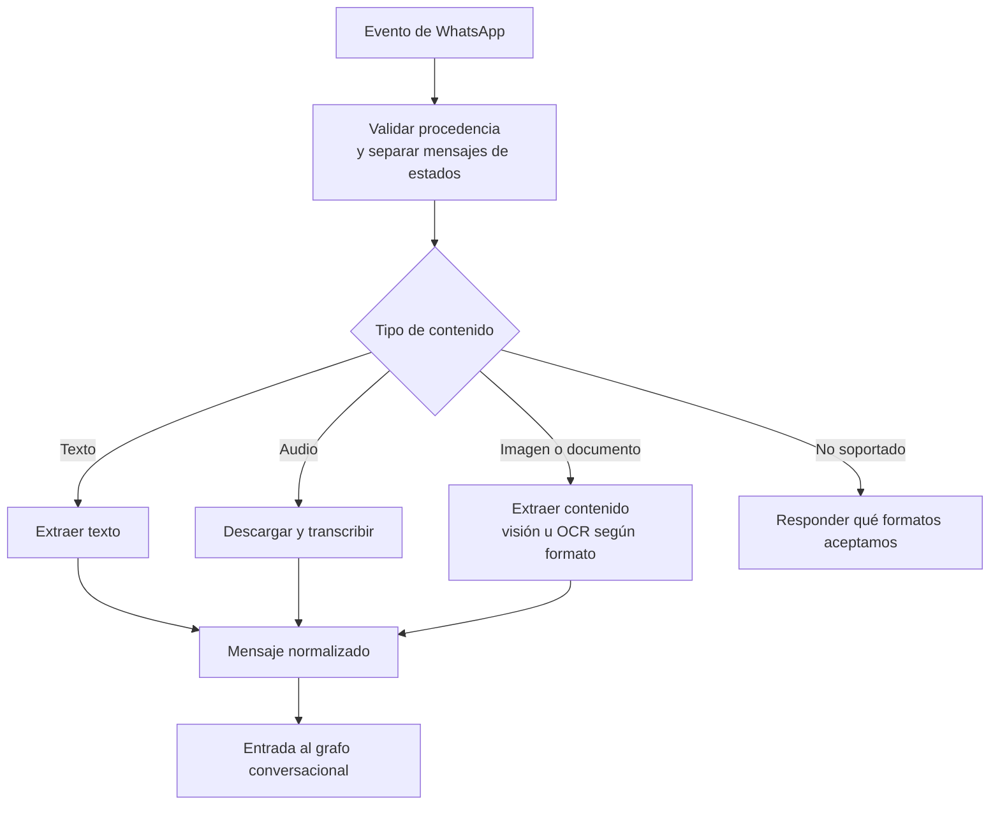
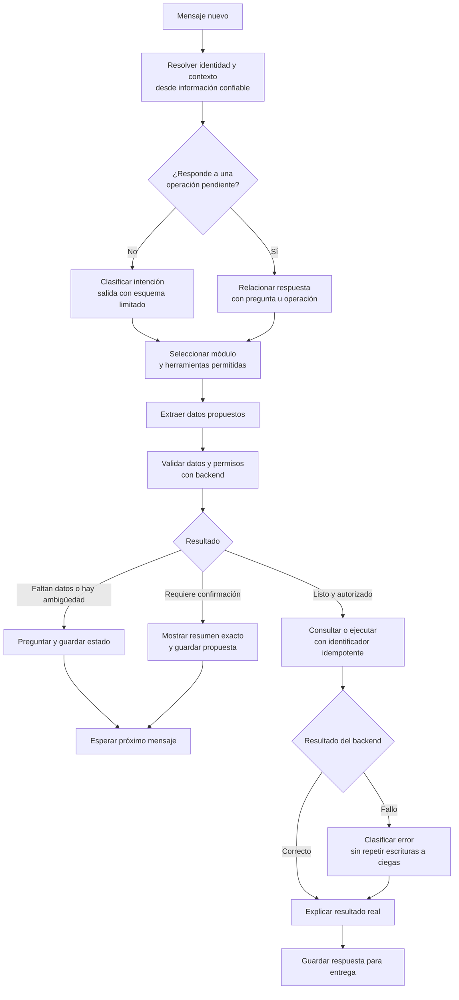
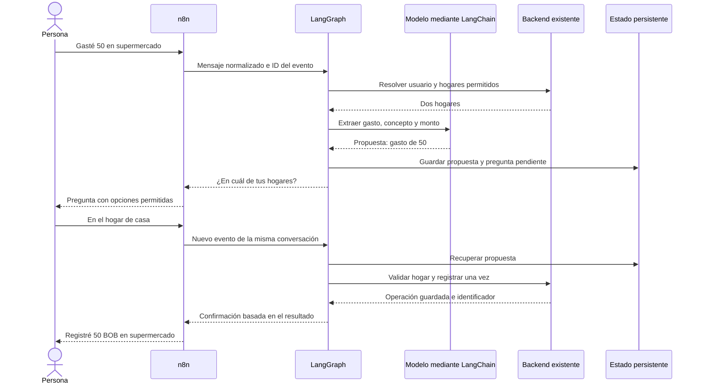
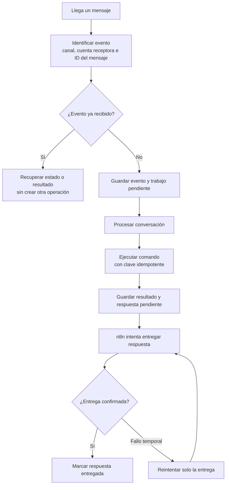

# Arquitectura propuesta de atención mediante IA

> **Estado: propuesta de diseño, no implementada.** Alcance: recibir mensajes, entenderlos, conducir la conversación, llamar a las operaciones existentes y responder. No rediseña la app, la contabilidad ni las tablas financieras.

## 1. Qué problema queremos resolver

Hoy “Hackathon - META” concentra recepción de WhatsApp, tratamiento de medios, un agente con numerosas herramientas y envío de respuestas. Al añadir funciones crecen tanto el diagrama como las decisiones que debe tomar el modelo.

La propuesta divide el trabajo por responsabilidades. No se trata de sustituir cada nodo por un agente: la mayoría de los pasos deben ser código predecible. La IA interviene para interpretar lenguaje y redactar, no para decidir permisos ni construir asientos.

| Pieza | Responsabilidad en la atención | Qué delega |
|---|---|---|
| **n8n** | Entrada/salida de canales, descarga de adjuntos, transcripción y extracción de contenido mediante proveedores. Flujos pequeños por función. | La dirección de la conversación y las operaciones del negocio. |
| **LangGraph** | Coordinar pasos, elegir módulo, mantener el estado, preguntar y reanudar operaciones pendientes. | Acceso a modelos y ejecución de operaciones financieras. |
| **LangChain** | Adaptadores para modelos, herramientas y salidas estructuradas cuando sean útiles. Es una biblioteca del servicio conversacional. | No es un segundo coordinador ni otro servidor obligatorio. |
| **Backend existente** | Identidad, permisos, validación de negocio, idempotencia y operaciones contables o de consulta. | No necesita interpretar conversaciones libres. |

**Un solo coordinador de conversación: LangGraph.** n8n no mantiene en paralelo otro agente decidiendo qué hacer con el mismo mensaje.

## 2. Vista general de la atención



El backend se muestra solo como una frontera: la arquitectura de IA utiliza sus operaciones, no las reimplementa.

La recepción HTTP confirma pronto que el evento quedó guardado. Un worker procesa después la conversación. Si hay que esperar una respuesta del usuario, se guarda el estado y se libera el worker; no se deja una ejecución HTTP abierta durante horas.

Los formatos de entrada convergen antes de llegar al grafo:



Los adjuntos necesitan límites de tamaño/formato y referencia al archivo original. Una extracción dudosa se marca para aclaración; no se transforma automáticamente en una operación confirmada.

## 3. Cómo decide el grafo



Una respuesta afirmativa reanuda la propuesta guardada, con los mismos datos. Si cambia el monto, el hogar o el cambio de moneda, se invalida la confirmación anterior y se prepara otro resumen. Se comprueban otra vez permisos y saldos al ejecutar.

Si llega otro tema mientras hay una operación pendiente, no se interpreta como confirmación por defecto: se distingue entre continuar, cancelar o atender una consulta independiente.

## 4. Módulos y herramientas pequeñas

| Intención | Módulo | Operaciones que puede solicitar |
|---|---|---|
| “Gasté 50 en supermercado” | Movimientos | Proponer registro de ingreso/gasto, consultar movimientos, solicitar una reversión permitida. |
| “¿Cómo vamos con el ahorro?” | Consultas | Leer reportes de presupuesto, pirámide, ahorro y patrimonio. Sin herramientas de escritura. |
| “Agrega a Ana al hogar” | Hogar | Consultar miembros y solicitar cambios autorizados. No conceder permisos por una instrucción del modelo. |
| “Pasa 700 a la bóveda en dólares” | Ahorro e inversiones | Consultar posiciones/bóvedas, preparar movimientos y ejecutar tras las comprobaciones requeridas. |
| “¿Qué puedes hacer?” | Ayuda | Explicar capacidades; no necesita acceso a herramientas financieras. |

Estos son módulos de atención, no cinco agentes autónomos obligatorios. Un nodo puede clasificar una intención y otro extraer un objeto, sin iniciar un bucle de herramientas.

El modelo recibe solo las herramientas necesarias para el módulo y los permisos resueltos por el sistema. Los permisos se vuelven a validar en backend: ocultar una herramienta no es una barrera de seguridad suficiente.

Los nombres de esta tabla son capacidades propuestas; no implican que ya existan endpoints nuevos con esos nombres.

## 5. Ejemplo: gasto con hogar ambiguo

**Usuario:** “Gasté 50 en supermercado”. Pertenece a dos hogares.



La moneda y la fecha por defecto salen del contexto verificado y la zona horaria del hogar, no de una fecha inventada por el modelo. Un nombre de hogar se resuelve contra los hogares autorizados. Los UUID de usuario/hogar no se aceptan como autoridad por venir de la IA.

Un gasto simple explícitamente solicitado puede registrarse sin una segunda pregunta si todos sus datos están claros. La política de confirmación se define por operación, no se deja a criterio libre del modelo.

## 6. Ejemplo: ahorro generado frente a dinero transferido

**Usuario:** “¿Cumplimos nuestra meta de ahorro este mes?”.

```mermaid
sequenceDiagram
    actor U as Persona
    participant G as LangGraph
    participant M as Modelo mediante LangChain
    participant B as Reportes del backend
    U->>G: ¿Cumplimos la meta este mes?
    G->>M: Clasificar consulta y periodo
    M-->>G: Reporte de ahorro del mes actual
    G->>B: Consultar hogar autorizado y periodo
    B-->>G: Meta 2000; ingresos 10000; gastos 8000; ahorro 2000
    B-->>G: Transferido a inversiones 2000, mostrado aparte
    G-->>U: Meta alcanzada hasta hoy: 2000 de 2000 BOB
```

El backend calcula los importes. La IA los explica, sin volver a calcular saldos desde el historial del chat.

- Si los 2.000 se invirtieron al principio del mes, no son un gasto.
- Si siguen en disponible al terminar el mes, también son ahorro generado.
- Si en febrero se invierten 2.000 ahorrados en enero, son una transferencia de febrero, no ahorro nuevo de febrero.

La atención consulta los reportes existentes (`f_monthly_pyramid_dashboard` y, para meses cerrados, `f_closed_month_savings_report`). Estas llamadas se harían con contexto autorizado; no se propone llamar una RPC dependiente de `auth.uid()` usando una clave privilegiada sin resolver la identidad del usuario.

## 7. Ejemplo: mover disponible a una bóveda en USD

**Usuario:** “Pasa 700 bolivianos a la bóveda Viaje en dólares”. La bóveda ya existe.

```mermaid
sequenceDiagram
    actor U as Persona
    participant G as LangGraph
    participant B as Backend existente
    participant S as Estado persistente
    U->>G: Pasa 700 BOB a Viaje en dólares
    G->>B: Consultar bóveda, permisos y disponible
    B-->>G: Destino USD y saldo disponible
    G-->>U: ¿Qué cambio quieres usar: manual o referencia online?
    U->>G: Usa 7 BOB por dólar
    G->>B: Validar y preparar importes
    B-->>G: Salen 700 BOB y entran 100 USD
    G->>S: Guardar propuesta con ID, versión y vencimiento
    G-->>U: Confirma: 700 BOB a Viaje, recibes 100 USD, cambio 7
    U->>G: Confirmo
    G->>S: Recuperar propuesta confirmada
    G->>B: Revalidar y ejecutar con el mismo ID
    B-->>G: Movimiento registrado
    G-->>U: Transferencia registrada; no es un gasto
```

Si se usa una cotización online, se guarda su referencia y fecha y se pide confirmar los importes. Si vence la propuesta o cambia el precio aplicable, se prepara y confirma una nueva. El cambio del ejemplo es ilustrativo.

Esta operación es un **registro interno en nuestro sistema**, no una transferencia bancaria ni una compra real en un exchange. Integrar movimientos reales de fondos requeriría otro diseño de autorización y ejecución.

## 8. Ejemplo: mensaje repetido o fallo al responder



Tres controles diferentes:

1. **Evento:** evita reprocesar el mismo webhook.
2. **Operación:** la BD devuelve el resultado existente si se repite el mismo comando. Un mensaje puede contener varias operaciones; cada una necesita su propio identificador estable.
3. **Respuesta:** si falla WhatsApp después de guardar un gasto, se reintenta enviar la respuesta, no registrar el gasto.

El checkpoint de LangGraph no garantiza por sí solo que una operación externa se ejecute una vez. La idempotencia debe llegar hasta la transacción del backend. Un timeout después de una escritura exige consultar su estado antes de repetirla.

La entrega de mensajes también puede quedar incierta tras un timeout. Una bandeja de salida facilita recuperarla, pero no permite prometer entrega exactamente una vez si el proveedor no ofrece esa garantía.

## 9. Contexto, límites y errores

La infraestructura de atención necesitaría persistencia propia, separada de los saldos financieros. Es una propuesta: este documento no añade tablas ni migraciones.

| Dato | Para qué sirve |
|---|---|
| Identidad verificada del canal | Relacionar el remitente con un usuario autorizado. Un teléfono escrito en el mensaje no autentica a nadie. |
| Conversación y hogar seleccionado | Continuar la conversación sin mezclar familias. Revalidar permisos al cambiar de hogar. |
| Intención y datos propuestos | Preguntar únicamente lo que falta, sin volver a interpretar todo. |
| Operación pendiente, versión y vencimiento | Relacionar una confirmación con una propuesta concreta. |
| Idioma, zona horaria y moneda | Respuestas consistentes; cálculos y fechas resueltos por el sistema. |
| IDs de evento, operación y correlación | Evitar duplicados y seguir la atención de extremo a extremo. |
| Checkpoint y respuesta pendiente | Reanudar tras un reinicio y recuperar la entrega. |

Serializar el procesamiento por conversación evita que dos mensajes simultáneos confirmen propuestas diferentes. Entre hogares/conversaciones independientes sí puede haber concurrencia. Si hay dos acciones pendientes, “sí” no basta: se debe identificar cuál confirma.

Los esquemas, límites de herramientas y permisos se comprueban en código. El contenido del usuario y de los adjuntos se trata como datos, no como instrucciones para cambiar permisos. Las credenciales permanecen en el servidor o en credenciales de n8n; no se incluyen en prompts ni estados de conversación.

| Resultado | Comportamiento propuesto |
|---|---|
| Falta información | Pregunta breve y estado pendiente. |
| JSON o esquema inválido | Corrección acotada de extracción; no repetir una escritura. |
| Sin permisos | Explicación clara y detener la operación. |
| Proveedor temporalmente caído | Reintento limitado con espera; alternativa o mensaje de fallo. |
| Backend responde `success: false` | No confirmar éxito aunque HTTP o n8n hayan terminado correctamente. |
| Límite de pasos alcanzado | Detener el bucle y dar una salida útil; registrar causa y correlación. |

Los registros técnicos deben indicar módulo, duración, uso del modelo, errores e identificadores. Evitar copiar tokens, adjuntos completos o conversaciones financieras innecesarias a logs. La retención de mensajes y checkpoints debe definirse antes de producción.

## 10. Cómo introducirlo sin rehacer todo

1. Separar en n8n entrada, preparación de contenido y salida. Normalizar los datos de WhatsApp y eliminar referencias heredadas a Telegram en ese recorrido.
2. Introducir un servicio conversacional TypeScript con LangGraph. Empezar por **consultas**, sin operaciones de escritura.
3. Añadir movimientos, con extracción estructurada, identidad verificada y protección contra duplicados. Reutilizar operaciones existentes y adaptar su autenticación donde sea necesario.
4. Incorporar administración del hogar y ahorro/inversiones con propuestas y confirmaciones explícitas.
5. Migrar cada intención por separado. Para un mensaje real, elegir un único ejecutor: el flujo antiguo o el nuevo, nunca ambos con permisos de escritura. Las comparaciones en paralelo deben ser de solo lectura o simuladas.

Se podría alojar este servicio junto al backend o como proceso independiente. No hace falta dividirlo en muchos microservicios. LangChain se usa donde simplifique adaptadores; no es obligatorio añadir otra capa si una llamada estructurada directa basta.

Antes de activar cada módulo, probar:

| Caso | Resultado esperado |
|---|---|
| Gasto completo | Un registro y confirmación del resultado real. |
| Dos hogares | Preguntar destino; no elegir uno arbitrariamente. |
| Audio ambiguo o ticket ilegible | Pedir aclaración antes de registrar. |
| Mismo webhook dos veces | Una sola operación. |
| Confirmación repetida | Recuperar la operación original. |
| Reinicio mientras espera confirmación | Recuperar propuesta y continuar sin duplicados. |
| Dos mensajes simultáneos | Procesamiento ordenado por conversación. |
| Timeout tras guardar | Consultar operación existente antes de reintentar. |
| Caída de WhatsApp tras guardar | Reintentar entrega sin volver a registrar. |
| Invertir ahorros anteriores | Reportar transferencia sin aumentar ahorro generado del mes. |
| Herramienta devuelve error de autorización | Detener escritura y explicar el problema. |
| Usuario cambia el monto tras confirmar | Nueva propuesta y nueva confirmación. |

## Referencias

- [LangGraph: coordinación de pasos deterministas y decisiones del modelo](https://docs.langchain.com/oss/javascript/langgraph/overview).
- [LangGraph: pausas, checkpoints y reanudación](https://docs.langchain.com/oss/javascript/langgraph/interrupts).
- [n8n: dividir workflows en componentes pequeños](https://docs.n8n.io/flow-logic/subworkflows/).
