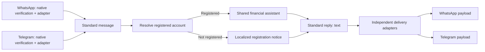

> **MCP update (2026-11-02):** The laboratory now uses one MCP Client Tool instead of the seven individual tools described below. Server and private health workflows are saved; new credentials and live MCP validation are pending. See [current MCP setup](../n8n/mcp/README.md). The following records the earlier channel implementation.

# One assistant, two messaging channels

Implemented in the unpublished [laboratory](https://dev-n8n.kplian.com/workflow/Mp1ACq1Zxypiktdg).
The production workflow, provider callbacks and existing user data are unchanged.

## Responsibilities

1. **Ingress and security.** Native WhatsApp and Telegram triggers verify their
   own provider's webhook. WhatsApp checks the Meta HMAC signature using its app
   secret; Telegram trigger versions above 1 verify the webhook secret. Generic
   unauthenticated webhooks and the old hand-written verification branch were
   removed from the laboratory. Financial conversations currently accept only
   private Telegram chats, not groups, channels, edited updates or bot senders.
   Delivery/read status events never reach the assistant.

   These checks are implemented by the
   [native WhatsApp trigger](https://github.com/n8n-io/n8n/blob/master/packages/nodes-base/nodes/WhatsApp/WhatsAppTrigger.node.ts)
   and [native Telegram trigger](https://github.com/n8n-io/n8n/blob/master/packages/nodes-base/nodes/Telegram/TelegramTrigger.node.ts),
   rather than custom cryptography in Code nodes. The saved draft has their real
   credential references, but its provider webhooks have not been activated or
   tested against real signed callbacks in this task.

2. **Standard input.** Adapters produce a message (`id`, `kind`, `text`, attachment
   metadata) and a separate private `transport` object. All messages in a batch
   are retained, then processed one at a time to keep each tool, file and reply
   bound to the right actor. The model sees only `message`, `user` display context
   and `locale`. Phone numbers, provider sender/chat/account IDs, file IDs, raw
   updates, signatures and reply destinations are excluded from its prompt.

3. **Registration gate.** `f_messaging_context_lab` resolves the active user by
   `(channel_type, channel_code)`. WhatsApp uses the verified sender number;
   Telegram uses `message.from.id`, not username, phone contact or forwarded
   author. The same numeric value in the two platforms does not imply the same
   person. Two linked channels with the same `tuser.id` share assistant memory.
   Missing, inactive and ambiguous identities cannot reach financial tools.

   A valid but unregistered sender receives a signup/linking notice without a
   model call or media download. A DB/configuration failure receives a temporary
   unavailability notice, not a misleading signup instruction. Accounts and
   channels are never created automatically. Linking still uses the existing
   application/admin channel management; this work adds no new signup UI or link.

4. **Shared assistant and tools.** The agent receives no channel configuration and
   returns `{ "text": "..." }`, validated by a structured response schema with no
   extra properties. Seven tools bind identity from the authorized context,
   outside `$fromAI`, through a backend-only RPC. The gateway validates identity
   again and limits reads/writes to active household memberships. Recording still
   uses the existing laboratory accounting engine and database server time.
   The existing bounded retry policy is preserved; it remains model guidance
   plus a four-iteration cap, not a deterministic per-tool circuit breaker.

5. **Independent output.** Standard replies are split conservatively without
   truncation, then the matching provider adapter builds the destination/payload.
   Telegram text is escaped for HTML and n8n attribution is disabled. Send errors
   stop the execution and are not automatically retried; delivery tracking and
   idempotency are not added by this change.

6. **Language before the assistant.** Generic notices have explicit Spanish,
   English and Portuguese translations. Selection uses a clear message-language
   signal or `/lang es|en|pt`, then profile locale, then Telegram's language hint.
   If none is reliable, the first notice is a short trilingual message. Phone
   country codes are not used to guess language. Text detection is a small
   deterministic heuristic, not a universal language detector. The assistant
   follows the current message language; its locale is only a fallback. Audio
   transcription no longer forces Spanish.

## Available financial tools

The shared gateway supports household lookup, transaction registration, budget
limits, recent movements, the configured pyramid breakdown, budget updates
(administrator only), and explicit creation of an additional household. Pyramid
and recent-movement tools are not implicitly filtered to the current month.

The previous `add_user_to_household` and `undo_last_action` nodes pointed to RPCs
absent from this database. They are not offered to the model in this laboratory;
direct gateway attempts return `TOOL_NOT_AVAILABLE`. No substitute user creation
or accounting reversal was invented. The active production workflow was not
changed. This is an existing feature gap, not a completed invitation/undo feature.

## Files and credentials

- `n8n/lib/messaging.mjs`: pure adapters, localization, neutral contracts and output
  formatting, tested without external services.
- `n8n/prompts/financial_agent_standard_prompt.md`: channel-independent purpose.
- `n8n/scripts/build-channel-laboratory.mjs`: reproducible sanitized graph builder.
- `n8n/workflows/channel-laboratory.spec.json`: generated graph with credential
  references only; no token values or embedded authorization headers.
- `20261102140000_messaging_channel_context.sql`: backend-only context/tool RPCs,
  applied and recorded in Supabase migration history.

The graph has 36 nodes, including media handling and tools, grouped into four
stages. With groups collapsed, seven items remain visible. Rebuild the source with
`node n8n/scripts/build-channel-laboratory.mjs`; rebuilding the file alone does not
update n8n. The earlier files under `n8n/patches/` document historical fixes and
must not be blindly replayed onto this renamed graph.

Telegram uses **Telegram account 2**. The latest Telegram execution found was 570
(2026-10-24); the workflow version retained before that execution uses this
credential. WhatsApp input uses **WhatsApp DEV**, output uses the previously
verified **Header Auth Meta 1**. All financial HTTP nodes use **Supabase account 2**.
Transcription now uses the managed **Groq account** credential, replacing an
embedded key. No credential secret was copied into the repository.

## Validation and remaining integration checks

- 49 local tests pass, including 23 new contract, language, isolation and graph
  tests. The earlier expression tests remain regression tests for historical fixes.
- `tests/messaging-channel-context.sql` passes against the deployed database with
  rollback: unknown/inactive/ambiguous senders, same-code cross-platform isolation,
  both-channel accounting entries, scoped reads, budget permissions and household
  creation. All fixture users/homes/journals disappear on rollback.
- n8n execution **1240** used the actual backend credential and new context RPC:
  an unregistered sender received a standard English registration notice and was
  blocked from assistant input. No message was sent.
- n8n execution **1241** used the actual model and response parser: a greeting
  produced `{text}` in English, with no tools, memory or outgoing messages.
- n8n execution **1242** injected two synthetic messages into the real shared
  normalization/loop/registration/reply pipeline with both send nodes disabled.
  The first sender got an English notice, the second a Spanish notice; recipients
  and context stayed separate across iterations and the AI Agent never ran. The
  temporary input nodes were removed and draft send nodes restored afterwards.
- n8n execution **1243** exercised the Telegram adapter and the real shared gate
  with sends disabled: a private Portuguese message received a Portuguese notice
  despite an English Telegram language hint; a group update was ignored. The AI
  did not run. Probe nodes were removed and draft send configuration restored.
- No real WhatsApp/Telegram message, file download, transcription or image/PDF
  analysis was performed. Image/document understanding still depends on the chosen
  model's capabilities; the adapter does not add OCR or vision to a text-only model.

**Do not activate this draft with production credentials casually.** Both providers
have a single webhook per app/bot; activating or testing their native triggers can
replace/conflict with the active callback. Use a dedicated test app/bot, or perform
an intentional cutover, before testing real signed callbacks and end-to-end replies.
