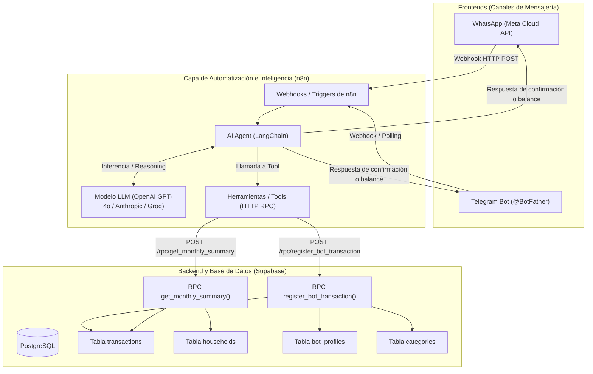

# Arquitectura del Sistema - AI Family Budget Bot

## Diagrama de Arquitectura

## Flujo de Datos

1. **Entrada de Usuario:** El usuario envía un mensaje o audio por WhatsApp o Telegram (ej: *"Gasté 45 Bs en el almuerzo"* o *"¿Cuánto hemos gastado en comida este mes?"*).
2. **Recepción en n8n:** El Webhook o Trigger de canal recibe el mensaje e identifica el remitente (`channel_user_id`, `display_name`).
3. **Razonamiento del Agente IA:** El AI Agent analiza el texto, infiere el tipo (gasto vs ingreso), monto, moneda, categoría y detalle.
4. **Persistencia en Supabase:** Invoca la función RPC de Supabase con seguridad `service_role`. La función verifica o crea el usuario y hogar, registra el movimiento y calcula el balance actual.
5. **Respuesta Inmediata:** El agente responde en lenguaje natural amigable y formateado con emojis al chat de WhatsApp o Telegram.
